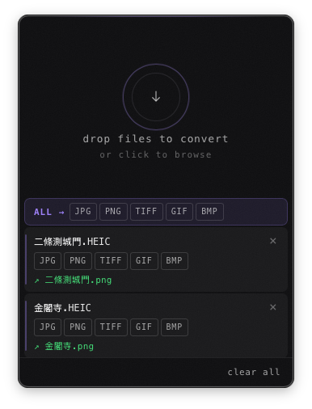

# Swift Shifter

A featherweight, always-on file converter that lives in your menu bar. Press a hotkey, type a few letters of a recent file, and convert it, or drop files onto the main window, all without opening a browser or bulky software.

<div align="center">

</div>

## Features

- **Quick bar** -- Ctrl + Shift + Space (or a click on the tray icon) opens a Spotlight-style search bar that suggests recently changed files from Desktop, Documents and Downloads; type to filter, Tab to pick a format (or type "photo to jpg"), Enter to convert. The shortcut and the scanned folders can be changed in Settings → quick
- **Drop zone** -- the main window, opened from the Dock / Start menu or the tray menu, accepts drag-and-drop from Finder or any file manager
- **Zero-friction UX** -- one click to pick the output format, conversion starts instantly
- **Broad format support**
  - Images: WebP, PNG, JPEG, AVIF, GIF, BMP, TIFF, HEIC/HEIF
  - Video: MP4, MOV, MKV, WebM, AVI, GIF (video-to-GIF and GIF-to-video)
  - Audio: MP3, AAC, FLAC, OGG, WAV, OPUS, M4A
  - Data: JSON, YAML, TOML, CSV
  - Documents: Markdown, plain text, HTML, LaTeX, Typst, PDF, EPUB (native engine + embedded typst for PDF; pandoc and pymupdf4llm/marker-pdf for the rest)
- **PDF merge** -- combine multiple PDF files into one in a dedicated merge mode
- **Clipboard integration** -- paste (⌘V) to load clipboard content for conversion; result written back to clipboard or saved to disk (configurable)
- **Output next to source** -- converted file lands in the same folder as the input (configurable)
- **Batch conversion** -- drop multiple files at once; common formats shown in a shared toolbar
- **Progress indicator** -- lightweight inline progress bar per file, no modal dialogs
- **Click to reveal** -- success label opens the output folder in Finder
- **Auto-update** -- checks for new releases on startup; installs in the background
- **Settings panel** -- configure output folder, JPEG/AVIF quality, concurrency and PDF conversion engine

## Tech Stack

| Layer                  | Technology                                                                                                                   |
| ---------------------- | ---------------------------------------------------------------------------------------------------------------------------- |
| App shell              | [Tauri v2](https://tauri.app)                                                                                                |
| Backend logic          | Rust                                                                                                                         |
| Image processing       | [`image`](https://crates.io/crates/image) crate + [`ravif`](https://crates.io/crates/ravif) for AVIF + macOS `sips` for HEIC |
| Video / audio          | System `ffmpeg` (install it yourself; the app says how)                                                                      |
| Document conversion    | Native Rust engine for Markdown / plain text / HTML / EPUB / Typst; `pandoc` for LaTeX input (install it yourself)           |
| PDF output             | [typst](https://typst.app) compiler linked in (no install, CJK font selection, TeX math via `mitex`)                         |
| PDF ↔ EPUB / HTML / MD | `pymupdf4llm` (install it with pipx); optional ML engine via `marker-pdf`                                                    |
| Data serialization     | `serde_json`, `serde_yaml`, `toml`, `csv` crates                                                                             |
| Frontend UI            | TypeScript + [Vite](https://vitejs.dev) (plain DOM, no framework)                                                            |
| Global hotkeys         | `tauri-plugin-global-shortcut`                                                                                               |
| System tray            | Tauri built-in tray API                                                                                                      |
| Auto-update            | `tauri-plugin-updater`                                                                                                       |

## Architecture Overview

```
swift-shifter/
├── swift-shifter/           # Rust/Tauri workspace member
│   ├── src/
│   │   ├── main.rs          # Tauri app entry point, window + tray + menu setup
│   │   ├── config.rs        # Persisted settings (quality, concurrency)
│   │   ├── clipboard.rs     # Clipboard read/write (paste-to-convert, copy result back)
│   │   ├── hotkey.rs        # Global shortcut registration
│   │   ├── tray.rs          # System tray icon and menu
│   │   └── converter/
│   │       ├── mod.rs       # Dispatcher: routes files to the right converter
│   │       ├── image.rs     # image crate + ravif (AVIF) + sips (HEIC)
│   │       ├── media.rs     # ffmpeg subprocess wrapper
│   │       ├── data.rs      # JSON/YAML/TOML/CSV converters
│   │       └── document/    # native engine + embedded typst, pandoc, pymupdf4llm/marker-pdf
│   │           ├── mod.rs
│   │           ├── binaries.rs  # finding the external tools
│   │           ├── conversion.rs # conversion logic per format
│   │           ├── merge.rs     # PDF merge (combine multiple PDFs into one)
│   │           ├── types.rs
│   │           └── utils.rs
│   ├── capabilities/
│   │   └── default.json     # Tauri v2 permission grants
│   ├── Cargo.toml
│   └── tauri.conf.json
├── ui/                      # Frontend (loaded by Tauri webview)
│   ├── index.html           # Main drop-zone window
│   ├── settings.html        # Preferences window
│   └── src/
│       ├── main.ts          # Drag-drop, file picker, conversion UI logic
│       ├── settings.ts      # Settings panel logic
│       ├── style.css        # Main window styles (adaptive light/dark)
│       ├── settings.css     # Settings panel styles
│       └── tokens.css       # Shared design tokens
├── .github/
│   └── workflows/
│       ├── build.yml        # Compile check on macOS, Windows, Ubuntu, Fedora, Arch
│       └── release.yml      # On a v* tag: builds signed installers as a draft release
├── scripts/
│   ├── bump-version.sh      # Syncs version across package.json, Cargo.toml, tauri.conf.json
│   └── build-icons.sh
├── vite.config.ts
├── tsconfig.json
└── package.json
```

## Prerequisites

| Tool        | Version         | Notes                                      |
| ----------- | --------------- | ------------------------------------------ |
| Rust        | stable (≥ 1.78) | via `rustup`                               |
| Node.js     | ≥ 24            | for Tauri CLI and Vite                     |
| ffmpeg      | ≥ 6             | for video/audio                            |
| pandoc      | any             | for LaTeX (`.tex`) input                   |
| pymupdf4llm | any             | for PDF extraction; install it with `pipx` |

The app never installs these: when one is missing, the conversion that
needs it says how to install it, and `swift-shifter doctor` lists which
are found.

## Contribute to the Project

```bash
# Clone
git clone https://github.com/mtmatt/swift-shifter.git
cd swift-shifter

# Install dependencies (Tauri CLI + Vite + TypeScript)
npm install

# Run in dev mode (Vite hot-reload + Rust watch)
npm run tauri -- dev

# Build release binary
npm run tauri -- build
```

The release `.app` lands in `swift-shifter/target/release/bundle/`.

### Releasing a version

Releases are cut from the `release` branch, and tags are pushed by hand:

```bash
git switch release && git merge main
./scripts/bump-version.sh 0.2.0
git commit -am "chore: bump version to 0.2.0"
./scripts/check-version.sh v0.2.0
git push origin release
git tag v0.2.0 && git push origin v0.2.0
```

`bump-version.sh` syncs `package.json`, `Cargo.toml`, and `tauri.conf.json`, which must agree. Pushing the `v0.2.0` tag starts `release.yml`: it checks the tag against those three files, then builds the signed installers into a draft GitHub release, which a maintainer reviews and publishes. Afterwards, merge `release` back into `main`. Nothing creates tags automatically.

## CI / Release Pipeline

| Workflow      | Trigger                                   | What it does                                                                            |
| ------------- | ----------------------------------------- | --------------------------------------------------------------------------------------- |
| `build.yml`   | Push to `main` or `release`, PRs          | Compile check on macOS, Windows, Ubuntu, Fedora, Arch; runs the full test suite         |
| `release.yml` | `v*` tag pushed, or run by hand for a tag | Verifies the tag matches the version files, builds signed installers as a draft release |

## Roadmap

- [x] Core Tauri shell + system tray
- [x] Drop zone window with drag-and-drop
- [x] Global hotkey (Ctrl+Shift+Space) → quick bar with recent-file search
- [x] Image conversion (PNG/WebP/JPEG/AVIF/HEIC)
- [x] Data conversion (JSON/YAML/TOML/CSV)
- [x] Video/audio via ffmpeg subprocess
- [x] Progress events streamed to UI
- [x] Output folder reveal
- [x] Batch conversion with concurrency
- [x] Config file + settings panel
- [x] Handle ffmpeg and brew installation automatically
- [x] Auto-update via Tauri updater plugin
- [x] Windows and Linux support
- [x] CI/CD pipeline with signed releases
- [x] Document conversion (native engine, embedded typst for PDF; pandoc for the rest)
- [x] Images to PDF
- [x] EPUB <-> PDF
- [x] PDF/EPUB -> HTML and Markdown
- [x] PDF merge (combine multiple PDFs into one)
- [x] M4A audio format support
- [x] Clipboard integration (paste to convert; copy result back to clipboard)
- [x] OCR conversion (PDF/image → txt, md, tex, typst)

### Coming next

- [ ] A native LaTeX reader, so `.tex` input no longer goes through pandoc ([#73](https://github.com/mtmatt/swift-shifter/issues/73))
- [ ] Removing pandoc ([#74](https://github.com/mtmatt/swift-shifter/issues/74))
- [ ] Linking ffmpeg's libraries rather than running its binary ([#81](https://github.com/mtmatt/swift-shifter/issues/81))

## License

Copyright 2026 ShangJhe Li (mtmatt)

From v2.0.0, Swift Shifter is licensed under the GNU General Public License
v3.0 or later ([`LICENSE`](LICENSE), SPDX `GPL-3.0-or-later`).

v1.0.1 and earlier were released under the Apache License 2.0, and stay
under it. Code that came in under Apache-2.0 keeps its notices, and
third-party code keeps its own license, such as the vendored mitex Typst
scope (`swift-shifter/src/converter/document/native/typst/mitex/LICENSE`).
